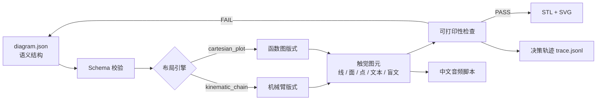

# 触见 TouchLearn

把 STEM 图重构成可触摸的 3D 结构图，配编号盲文和扫码音频。

2026 复旦大学未来智造智能体大赛 · Team Stella

TouchLearn 不是一个"把图片描一遍"的工具。它先要求输入一张图的**语义结构**（有哪些元素、谁和谁相连、关键点在哪），再由两个确定性布局引擎生成触觉版式，最后同时导出 STL、SVG 预览、可打印性报告、决策轨迹和中文音频脚本。所有产物都来自同一份 JSON，改一个数，版式、几何和讲解会一起变。

当前版本是 **v0.1.0**：两个案例已经能完整编译并通过自动检查，但**尚未实体打印，也尚未经过盲人用户测试**。这一点在 README、提交材料和演示中都会如实标注。

## 两个案例

| 案例 | 语义内容 | 布局引擎 | 触觉重点 |
|---|---|---|---|
| 六轴机械臂 | 8 个元素：基座、3 段连杆、J1–J3、J4–J6 腕部、末端夹爪 | `kinematic_chain` | 串联运动链、关节顺序、腕部三轴不糊成一团 |
| 二次函数 `y = x² − 2x − 3` | 8 个元素：曲线、顶点、两个根、对称轴、坐标轴、原点 | `cartesian_plot` | 曲线走向、顶点与根的位置、对称轴 |

两个案例都是 A5 竖版（148 × 210 mm）触觉板。机械臂用编号 1–8 的盲文索引，配合 A6 图例卡；函数图用编号 1–3 标出顶点和两个根，其余元素用短盲文标注。

## 快速开始

### Windows 自带 Python（本仓库的开发环境）

仓库里的 Python 是嵌入式发行版，不读 `PYTHONPATH`，也没有 setuptools。直接用引导脚本：

```bash
python scripts/dev_cli.py validate examples/robot_arm/diagram.json
python scripts/dev_cli.py check examples/robot_arm/diagram.json
python scripts/dev_cli.py all examples/robot_arm/diagram.json -o dist/robot-arm-6axis
```

构建两个案例并刷新 `dist/`、`docs/images/` 和清单：

```bash
python scripts/build_examples.py
```

跑测试：

```bash
python -m unittest discover -s tests -t .
```

### 普通 Python 环境

```bash
python -m venv .venv
# Windows: .venv\Scripts\activate
# macOS/Linux: source .venv/bin/activate
pip install -e ".[dev]"
touchlearn all examples/quadratic/diagram.json -o dist/quadratic-y-x2-2x-3
```

可选依赖：

- `pip install -e ".[qr]"`：生成二维码（需要 `qrcode[pil]`）。
- `pip install -e ".[ui]"`：启动 Streamlit 预览界面。

```bash
streamlit run app/streamlit_app.py
```

## 一次编译产出什么

`dist/<diagram.id>/` 下固定七个文件。两个案例的目录是 `dist/robot-arm-6axis/` 和 `dist/quadratic-y-x2-2x-3/`：

| 文件 | 内容 |
|---|---|
| `model.stl` | 二进制 STL，可作为 A5 触觉板直接切片 |
| `preview.svg` | 与几何同源的矢量预览，不是另画的一张图 |
| `legend.svg` | A6 图例卡，编号对应英文名和中文名 |
| `report.json` | 可打印性指标与问题清单 |
| `trace.jsonl` | 每一步布局决策、理由和证据 |
| `audio.txt` | 中文讲解脚本，含停顿与制作说明 |
| `diagram.json` | 本次编译使用的输入快照 |

此外 `dist/manifest.json` 记录两个案例的 STL SHA256、三角形数、体积和检查结论。

当前构建结果：

| 案例 | 三角形 | 体积 | 水密 | 最小标签间距 | 结论 |
|---|---:|---:|---|---:|---|
| 机械臂 | 18,756 | 96,938.755 mm³ | 是 | 5.4 mm | PASS |
| 二次函数 | 20,652 | 95,555.098 mm³ | 是 | 4.8 mm | PASS |

数字会随版式调整变化，以 `dist/manifest.json` 和 `report.json` 为准。

## 工作流



关键约束：

- **语义是唯一真源**。布局引擎不读图片像素，曲线由 `a/b/c` 系数采样生成，关节位置由运动链和画布约束决定。
- **先检查，再出件**。边距、最小线宽、标签间距与净空、二维码区域、浮雕高度、网格边界、体积方向、水密性任何一项失败，构建返回非零退出码。
- **决策可追溯**。`trace.jsonl` 记录"选了什么引擎、为什么、腕部放大板多大、编号为什么用数字"，方便复盘和答辩。
- **核心零依赖**。三角化、棱柱、STL、盲文和笔画字体全部用标准库实现，换一台没有 CAD 的电脑也能复现。

详细设计见 [docs/architecture.md](docs/architecture.md)，触觉规格见 [docs/tactile_spec.md](docs/tactile_spec.md)。

## 仓库结构

```text
src/touchlearn/          编译器核心
  model.py               语义模型
  schema.py              JSON Schema + 手写校验
  layout.py              两个确定性布局引擎
  braille.py             UEB 盲文编码与点阵
  font.py                3×5 笔画字体
  geometry.py            耳切三角化、棱柱、网格
  printability.py        可打印性与触觉安全门禁
  svg.py                 SVG 预览
  stl.py                 二进制 STL
  audio.py               音频脚本
  legend.py              A6 图例卡
  trace.py               决策轨迹
  cli.py                 命令行入口
examples/                两个案例的 diagram.json
schemas/                 对外 JSON Schema
tests/                   47 项单元测试
scripts/                 本地引导、双案例构建、二维码工具
app/streamlit_app.py     可选预览界面
docs/                    架构、规格、运行、盲测、提交、路线图
dist/                    已提交的两个案例产物
```

## 当前状态与边界

已经做到的：

- 两个案例端到端编译，47 项测试通过；
- 两个网格水密、体积为正、尺寸 148 × 210 × 3.8 mm；
- 可打印性检查覆盖边距、线宽、标签碰撞、二维码侵入、浮雕范围和网格完整性；
- 输入快照、报告、轨迹、音频脚本和 STL 一次生成。

尚未做到的，不在 README 里含糊：

- **没有实体打印**。STL 只经过几何与水密检查，未经切片软件和真实打印机验证。
- **没有盲人用户测试**。`docs/blind_test_protocol.md` 是可执行的测试方案，不是已完成的结论。
- **二维码还没有指向线上音频**。当前交付音频脚本，TTS 和托管属于制作环节；`scripts/make_qr.py` 可在拿到 URL 后生成二维码。
- **图例卡是 A6 打印件**，不是独立触觉板；盲文索引本身已经在 A5 板上。
- **只支持两个案例和两个引擎**。输入不是任意图片；从照片到语义结构的上游提取在 v0 中由人工完成，并在 `diagram.json` 中显式记录。

## 文档

- [架构与数据契约](docs/architecture.md)
- [触觉板规格](docs/tactile_spec.md)
- [Windows 运行说明](docs/run_windows.md)
- [盲测方案](docs/blind_test_protocol.md)
- [初赛提交清单](docs/submission.md)
- [路线图](docs/roadmap.md)

## 许可

代码使用 MIT License，见 [LICENSE](LICENSE)。文档、示例 JSON、生成的触觉板设计与预览使用 CC BY 4.0，见 [LICENSE-docs](LICENSE-docs)。

仓库不包含任何第三方照片；机械臂是原创示意图，不复制具体厂商的产品图。
