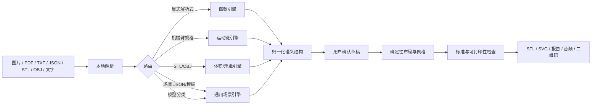

# 触见 TouchLearn

把多模态 STEM 学习材料转成**可打印、可触摸、可扫码听讲**的触觉产物。

2026 复旦大学未来智造智能体大赛 · Team Stella

TouchLearn 不是两个写死的案例。它是一套通用的“理解 → 确认 → 生成 → 合规检查”智能体：函数图和机械臂只是两个演示样例，电路、流程图、几何图形、坐标系、路线图、柱状图、细胞结构，以及用户上传的场景 JSON，都可以走同一条链路。核心几何、STL 和标准检查完全本地确定性执行；大模型只负责理解，不负责编造尺寸。

产物分三类，可以在输入栏中间同时勾选：

- **触觉教材生成**：可打印的平面触觉板，表达位置、连接关系和阅读顺序，类似用凸点“印”在纸上的触觉书。板面按内容复杂度自动选择 A5 / A4 / A3，最小 A5。
- **触觉 3D 模型生成**：一句话交给 TokenHub 上的三维生成模型（默认 Tripo 3.1，可切 HY-3D 3.1 / 3.0），直接得到带细节的完整网格，再由本地确定性内核统一缩放、加底座、加中文盲文标题、定义正面方向、留二维码位并做可打印性检查。不再用基础几何体拼装；太阳系目录和离线环境仍走本地编译器兜底。
- **照片级 3D 重建**：上传 1–4 张照片，调用腾讯云 TokenHub（混元 3D / Tripo）或 Tripo 3D、Meshy 还原带纹理的 GLB；再用自然语言说明要保留或调整什么、打印高度、底座形状和中文盲文名称。本地补底座、盲文图例和二维码位，输出单色可打印 STL。TokenHub 可与文本模型共用同一个 Key。

当前版本 **v0.3.5**。已经能端到端生成 STL、预览、合规报告、音频和二维码；**尚未完成实体打印验证和盲人用户测试**，这两点在本文和提交材料里都如实标注。

## 它解决什么问题

| 用户给出 | 智能体理解成 | 用户确认后得到 |
|---|---|---|
| 函数图片或 `x^2-2x-3` | 解析式、视窗、零点、极值 | 自动定尺寸的函数触觉板（A5–A3） |
| 机械臂照片、工程图、文字描述 | 自由度、连杆、关节、末端 | 缩放立体模型或自动定尺寸浮雕板 |
| STL / OBJ | 网格健康、包围盒、水密性 | 缩放立体或高度场浮雕 |
| 电路/流程图/几何/细胞/路线/柱状图 | 图块、图元、阅读顺序 | 自动定尺寸的结构触觉板（A5–A3） |
| “太阳系3D模型”“八大行星” | 行星数量、相对半径、轨道、中文名称 | 带底座和底座外缘盲文图例的立体 STL |
| 其他立体需求（机械臂、水杯、地球仪、台灯、火箭等） | 对象描述与关键特征，整理成生成提示词 | 三维生成模型输出完整网格，本地统一加标题、底座和方向适配 |
| 同一物体的 1–4 张照片 + “保留羽毛，展开翅膀，高 120 毫米” | 重建对象、保留/调整项、高度、底座、盲文名称 | 带纹理 GLB + 带底座/盲文标注的可打印 STL |
| PDF / TXT / JSON | 文字层或扫描页图像、场景结构 | 对应的函数、机械臂、场景或 3D 草稿 |
| 无法结构化的散文 | 明确拒绝 | 不生成无意义的板子 |

输出统一包含：`model.stl`、`preview.svg`、`compliance.json/md`、`diagram.json`（平面板）或 `model_spec.json`（3D 模型）、`decision_trace.json`、`manifest.json`、中文音频脚本与播放页、二维码贴纸、打印说明。文字生成三维模型时额外输出 `generation.json`、`model_textured.glb`（若服务返回）、`model_view.html`；照片级重建还会额外输出 `model_textured.glb`、`thumbnail.png`、`photo_view.html` 和 `reconstruction.json`。同时勾选两类产物时，3D 作业里还会额外生成 `plate_model.stl`、`plate_preview.svg` 和 `plate_diagram.json` 作为配套总览板。用户拿 STL 去自己的切片软件和打印机，主链路到下载为止。另有一个**默认关闭的可选扩展**：管理员配置 OctoPrint 或 Klipper / Moonraker 后，作业卡上可以“发送到打印机”，服务端先做文件格式、文件体积、三角面数量、打印床贴合和合规结论五项检查，用户确认后才上传并请求开始打印；未开启时只做演练，不连接任何设备。详见 [docs/printer-integration.md](docs/printer-integration.md)。

## 快速开始

### 1. 启动交互式前端（推荐）

仓库自带嵌入式 Python，不读 `PYTHONPATH`，用启动脚本：

```bash
python scripts/run_agent.py --port 8765
```

浏览器打开 `http://127.0.0.1:8765`。默认监听 `0.0.0.0`，同一 Wi-Fi 下的手机可以扫码访问音频页。

关闭自动打开浏览器：

```bash
python scripts/run_agent.py --port 8765 --no-browser
```

界面是移动端优先的聊天式工作台：上传入口只有一个，函数、机械臂、STL/OBJ、PDF/图片、示意图都走同一个对话框；理解结果以草稿卡出现，确认后才生成。输入栏中间有“触觉教材”“触觉3D模型”“照片级3D重建”三个开关，默认只开触觉教材；可以单独开 3D 或重建，也可以组合勾选。选择会记在浏览器本地，并随下一次请求发送给后端。输入框上方的模型按钮可以随时切换当前实例提供的模型和思考强度（低/中/高；只有支持推理开关的预置会显示该菜单），选择只影响下一次请求并记在浏览器本地；右上角是账户中心，可以改昵称、绑定或解绑手机号/邮箱、退出登录，齿轮里可以查看当前模型、二维码基础地址和账号状态。

#### 账号与登录

- 用**手机号验证码**或**邮箱验证码**登录，第一次验证通过后自动创建账号，不需要密码。
- 每个手机号或邮箱在实例内唯一对应一个账号；登录后可以把另一种联系方式绑定到同一账号，绑定后两种方式都能登录。
- 登录状态保存在 HttpOnly Cookie 中，默认 30 天；退出登录会立即失效。
- 生产环境至少配置一种验证码通道：SMTP 邮件或阿里云短信。两者都未配置时，服务会回退到开发模式，验证码直接显示在页面上，并在启动日志里打印醒目警告；公网部署前必须关闭。
- 账号库是 SQLite，默认 `<outputs>/accounts.sqlite3`，Docker 部署时位于持久卷，重新部署不会丢账号。

首页的“串联电路 · 可编辑”不是文字示例，而是一张预置好的可编辑电路图：电池、开关、电阻、灯泡和闭合导线都已就位。拖动元件、改标签、切换开关，或直接输入“把灯泡换成电动机”，都由服务端重新编译语义模型并返回新的 SVG；导线按元件位置确定性生成，不会悬空。上传电路图片时先识别元件与连接关系，再进入同一个编辑器确认。函数和机械臂示例则只把需求填进输入框，不会自动发送。

#### 手机、平板与其他设备

- **同一 Wi-Fi**：启动后直接用 `http://<电脑局域网 IP>:8765` 打开；默认监听 `0.0.0.0`，不需要额外配置。
- **临时公网**：`python scripts/run_public.py` 会启动 Cloudflare Quick Tunnel，生成一个 `https://*.trycloudflare.com` 地址，任何设备都能打开。电脑休眠或进程停止后地址失效。
- **固定公网**：仓库包含 `deploy/`（Docker Compose + Caddy 自动 HTTPS）、`Dockerfile`、`render.yaml` 和 `Procfile`。自有服务器的 ECS/VPS 选型、配置、备案、部署、备份和排障见 [deploy/README.md](deploy/README.md)；Render/Railway 路线与平台差异见 [docs/deploy.md](docs/deploy.md)。

分析和生成接口需要登录，登录方式见上面的“账号与登录”。已经生成的产物链接按不可猜测的作业 ID 公开，方便手机扫码听讲解。

### 2. 接入大模型（可选）

不配置也能离线演示：分类走关键词，函数走正则，场景走 8 个离线模板，图片只留档不猜。要启用图片理解和自由文字生成场景，复制 `.env.example` 为 `.env`，填一个 OpenAI 兼容服务：

```dotenv
TOUCHLEARN_LLM_PROVIDER=tokenhub
TOUCHLEARN_LLM_KEY=sk-...
TOUCHLEARN_LLM_MODEL=deepseek-v4.1-flash
```

这里的 `TOUCHLEARN_LLM_MODEL` 和 `TOUCHLEARN_LLM_EFFORT` 只是**初始默认值**：服务启动后，用户可以在页面模型菜单里切换到当前实例提供的其他模型和思考强度，不需要改 `.env` 或重启。视觉模型默认复用同一预置；自定义网关时再填 `TOUCHLEARN_VLM_*`。支持腾讯云 TokenHub、OpenAI、DeepSeek、阿里云百炼/通义千问、月之暗面/Kimi、智谱 GLM、本地 Ollama/vLLM 和任意兼容接口。详细配置、端点语义、失败行为见 [docs/providers.md](docs/providers.md)。

密钥只从环境变量或本机 `.env` 读取，不写入作业目录，状态接口只返回 `has_key`。

要启用文字 / 照片生成三维模型，再加一个三维服务配置（TokenHub 可直接复用上面的 LLM Key）：

```dotenv
TOUCHLEARN_3D_PROVIDER=tokenhub
TOUCHLEARN_3D_KEY=              # 留空则复用 TOUCHLEARN_LLM_KEY
TOUCHLEARN_3D_TEXT_MODEL=tripo-3d-3.1
TOUCHLEARN_3D_MODEL=tripo-3d-p1 # 图生 3D 默认；支持单图 input 与多视图 inputs
TOUCHLEARN_3D_QUALITY=high      # draft / standard / high
TOUCHLEARN_3D_GENERATIVE=1      # 0 可强制回退到本地结构化编译器
```

`tripo-3d-3.1` 支持最高 150 万面，是默认的文字生成模型；也可以改成 `hy-3d-3.1`、`hy-3d-3.0`、`tripo-3d-p1`、`tripo-3d-p2` 或 `hy-3d-express`。模型族不同，请求字段会自动切换，不需要手改协议。生成结果仍由本地统一加标题、底座、方向、盲文和二维码位。

### 3. 命令行构建两个基准案例

```bash
python scripts/dev_cli.py validate examples/robot_arm/diagram.json
python scripts/dev_cli.py all examples/robot_arm/diagram.json -o dist/robot-arm-6axis
python scripts/dev_cli.py all examples/quadratic/diagram.json -o dist/quadratic-y-x2-2x-3
```

刷新两个案例的 `dist/`、`docs/images/` 和清单：

```bash
python scripts/build_examples.py
```

### 4. 普通 Python 环境

```bash
python -m venv .venv
# Windows: .venv\Scripts\activate
# macOS/Linux: source .venv/bin/activate
pip install -e ".[dev]"
touchlearn all examples/quadratic/diagram.json -o dist/quadratic-y-x2-2x-3
```

可选依赖：

- `pip install -e ".[docs-reader]"`：读取 PDF 文字层（`pypdf`）。
- `pip install -e ".[qr]"`：二维码（已包含在基础依赖里）。

### 5. 跑测试

```bash
python -m unittest discover -t . -s tests
```

测试不调用任何付费接口；模型接入用本机临时 HTTP mock。

## 架构



关键约束：

- **生成层与确定性层分离**。文字或照片交给三维生成模型负责“像不像”；标题、底座、方向、盲文、二维码和 PASS/FAIL 由本地确定性内核负责，生成模型不能改合规结论。
- **语义是唯一真源**。场景用归一化 0–100 坐标，模型不给毫米；函数曲线由系数采样；机械臂由运动链计算。
- **模型不改合规结论**。PASS / DEVIATION / NEEDS_REVIEW / FAIL 全部由本地规则引擎产生。
- **先确认再构建**。草稿可改函数视窗、机械臂参数、场景标题；未确认不生成 STL。
- **离线可复现**。三角化、棱柱、STL、盲文和笔画字体用标准库实现；8 个模板断网可用。
- **不确定就拒绝**。看不清的图片、无法光栅化或整页空白的 PDF、无法结构化的散文，不会被硬编成一个结构。有文字层时直接读文字；没有文字层的扫描件会先用 PyMuPDF（或 poppler）渲染成页面图片，再交给视觉模型理解，而不是假装读到了文字。

## 通用场景编译器

当前支持 8 个离线模板：三角形与高、3-4-5 直角三角形、串联电路、流程图、平面直角坐标系、路线图、柱状图、植物细胞。

场景图元包括线/折线/路径、多边形、矩形、圆、椭圆、箭头、圆弧、点、文字、盲文。最多 12 个图块，每块最多 48 个图元；按阅读顺序自动编号，标签在全部几何生成后统一做碰撞避让，并避开标题和二维码区。

8 个模板都通过了网格水密和可打印性检查，无 FAIL。它们仍只是**结构示意图**：表达位置、连接关系和顺序，不还原照片细节，也不代表真实尺寸。

## 触觉 3D 模型

“触觉3D模型”不是把一张平面板竖起来，而是一条独立的立体装配链路：

```text
文字/图片/扫描 PDF
   ↓  大模型只做语义理解
严格 JSON（kind / parts / shape / size / position / labels）
   ↓  本地确定性编译器，不让模型直接吐网格
底座 + 支架/立柱 + 主体部件 + 部件表面盲文/底座图例 + 二维码平台
   ↓
二进制 STL + 3D 预览 SVG + model_spec.json + 合规报告
```

**内置太阳系目录**。输入“需要一个太阳系3D模型”时，即使没有配置大模型也能离线生成：太阳 + 7 颗行星（说“八大行星”时为 8 颗），行星分布在 7 条同心类圆形轨道上。行星直径只有 9–25 mm，放不下 25–53 mm 的中文盲文名称，所以名称按离太阳由近到远的顺序刻在底座外缘的圆柱面上；从正面标签牌左侧起，绕底座一周摸读。不生成竖立名牌。行星半径保留真实大小顺序（木星最大、水星最小），但经过 `4.2 + (ratio/max)^0.42 × 8.4` 的压缩，否则木星和地球放在同一个 220 mm 打印空间里无法同时看清。轨道只表达相对顺序，不是等比例太阳系，合规报告会把它标为 `DEVIATION` 而不是悄悄略过。

**其他立体需求**走同一套结构：大模型输出 `parts`（每个部件的形状、相对尺寸、位置、中文名称），本地编译器负责底座尺寸、部件防碰撞、支架、表面盲文排版和盲文点阵。模型不直接生成三角面，避免不可打印的悬空几何和无法核验的尺寸。

**盲文标注**使用 GF 0019-2018 汉语盲文二级标调，点径 1.6 mm、点高 0.8 mm。标注优先直接刻在部件可触摸的表面：球体用球冠、圆柱/圆台/空心管用侧壁、盒子和薄板用顶面、机翼/尾翼用轮廓侧面。表面放不下时，部件全名按 `1部件名`、`2部件名` 的编号顺序集中刻在底座前缘，不截断名称，也不生成竖立名牌。标题盲文和二维码平台在底座正面。平面触觉板仍使用 UEB 字母和阿拉伯数字。

**盲文不是由大模型“随手画点”**。每个字先查内置拼音表得到带调音节，再按 GF 0019-2018 的声母、韵母、声调规则编码成 6 点单元；同一个字每次生成的点阵完全一致。声调在四声和轻声的省略规则下会让不同音节的格数不同，所以“站立小狗”是 10 个单元、28 个点，而不是每个字固定几个点。标题过长时现在会自动换成 1–3 行并居中，不再静默截断；底座放不下时，界面会明确提示“标题被截断”，不会用剩下的字冒充完整名称。打印卡里的“盲文对照（给明眼人看）”会把每个字的拼音、点号（1–6）和 2×3 点格画出来，README 也会附同样的对照表；如果标题含盲文表未收录的生僻字，任务会在调用三维服务前直接报错并指出是哪个字，避免底座印出与名称不符的盲文。

**尺寸与打印**。太阳系底座半径 102 mm，通用装配体和重建模型的底座半径上限 88 mm，整件必须落在 220×220×250 mm 打印空间内；超过时会被拒绝或压缩，而不是生成一个打印不了的模型。3D 模式使用 0.4 mm 喷嘴、0.16 mm 层高、3 圈墙线、15% 填充，长悬空和太阳立柱建议树状支撑，并让支撑避开盲文面；不要开启顶面熨烫，否则 0.8 mm 的盲文点会被抹平。当前太阳系样例为 205.6×219.8×69.2 mm、25,632 个三角面、水密、最小网格边 0.2396 mm，可打印性 PASS。

**要不要训练/微调大模型**：v1 不需要。这里的大模型只承担“把自然语言和图片理解成结构化规格”的工作，几何、尺寸、盲文和合规全部由本地确定性代码负责，因此不存在“模型画得不像”的问题，也不需要收集大量 STL 去微调。只有将来要做**自由曲面网格生成**（例如照片级人头、复杂雕塑）或把部件覆盖扩展到成百上千类时，才值得考虑用配对数据做微调或训练专用几何模型；那会把可打印性和尺寸核验的难度提高一个量级，不适合作为当前版本的前置条件。

## 照片级 3D 重建

这条链路把“照片里长什么样”和“打印出来能不能摸、能不能装”分开处理：

```text
1–4 张照片 + 文字指令
   ↓  视觉/文本模型只写重建计划（subject / keep / changes / height / base / labels）
严格 JSON（不生成网格、不编造尺寸）
   ↓  TokenHub（tripo-3d-p1 / hy-3d-3.1）或 Tripo、Meshy 的 image-to-3D 接口
带纹理的 GLB + 缩略图
   ↓  本地标准库解析 GLB 三角面与节点变换
按目标高度缩放、居中、落到 z=0，必要时反转绕序
   ↓  本地确定性后处理
底座/前舌 + 支撑柱 + 中文盲文标题铭牌 + 部件编号图例 + 二维码位
   ↓
model.stl + model_textured.glb + preview.svg + photo_view.html + reconstruction.json + 合规报告
```

**文字指令怎么生效**。大模型把“保留羽毛纹理，把翅膀展开，高 120 毫米，底座用圆角矩形，名称叫小鸟和翅膀”拆成 `keep_features`、`changes`、`height_mm`、`base`、`labels`，显示在确认卡里供用户修改。高度、底座、留白、盲文名称、二维码位由本地确定性地执行；姿态和几何编辑会写进 provider prompt，但最终是否支持取决于服务商，服务不支持时会保留照片原样，报告里标为待复核，而不是假装改成功了。

TokenHub 的图生 3D 接口不允许 `prompt` 与照片同时提交，因此走 TokenHub 时文字指令只执行高度、底座、留白、盲文名称和二维码位这些本地可确定的部分，姿态编辑会明确标为“未转发”，不会假装模型改了姿势。需要按文字重构姿态时，应改用支持 prompt + image 的服务商，或分多角度照片重建。默认 `tripo-3d-p1` 支持 2–4 张 `front/left/back/right` 多视图；公网部署会把照片临时发布成 HTTPS 链接再交给 TokenHub，重建结束立即删除。

**配置**：

```dotenv
TOUCHLEARN_3D_PROVIDER=tokenhub   # 或 tripo / meshy
TOUCHLEARN_3D_KEY=                # 留空时 tokenhub 复用 TOUCHLEARN_LLM_KEY
TOUCHLEARN_3D_MODEL=tripo-3d-p1   # 图生默认；也可用 hy-3d-3.1（image_base64）
TOUCHLEARN_3D_FACES=300000        # 图生面数，3000–2000000
TOUCHLEARN_3D_TIMEOUT=600
TOUCHLEARN_3D_POLL=4
```

TokenHub 单张照片上限约 6 MB，支持 PNG/JPEG/WEBP，分辨率 128–5000 px；当前 TokenHub 路径使用第一张照片做单图重建，多角度融合请改用 Tripo。未配置密钥时，前端会明确提示该模式未启用，触觉教材和本地确定性 3D 模型不受影响。密钥只从环境变量或本机 `.env` 读取，不写入作业目录，`/api/health` 只返回 `configured`、`provider`、`has_key` 一类状态，不返回密钥。

**必须说清楚的限制**：

- 纹理和颜色只保留在 GLB；FDM 单色打印不会保留照片颜色。
- 重建网格不是测量数据，目标高度是缩放值，不是真实尺寸。
- 服务商返回的网格可能有开放边或退化面；报告把水密性问题标为 `NEEDS_REVIEW`，切片前要用修复工具检查。
- 照片质量、遮挡和反光会直接影响重建结果；缺面或糊成一团时应该换照片重试，而不是让模型猜。
- 中文盲文标题在底座正面铭牌，特征名按编号刻在底座前缘图例；重建网格没有可靠的部件坐标，所以不在模型表面刻猜出来的名字，也不生成竖立名牌。部件全名不会被截断，放不下时整条转入底座图例。

## 标准依据

主依据是 [GB/T 40142-2021《触摸图形设计及图例》](https://openstd.samr.gov.cn/bzgk/std/newGbInfo?hcno=E72CE9A9B4200759B27F08F13118F5B8)，盲文点阵依据 [GB/T 39758-2021](https://openstd.samr.gov.cn/bzgk/std/newGbInfo?hcno=63A112B519D601DBA74264AAEB314DB0)（等同 ISO 17049:2013）。同时核对了 GB/T 44725-2024、GF 0019-2018、国歌盲文方案、GB/T 45281-2025、GB/T 45567-2025、GB/T 18028-2010 的适用范围和状态。

必须说清楚的三点：

- GB/T 40142 的公开 PDF 只有封面和目录，仓库里的点径、线高、标注距离来自民政部公开解读，属于**公开摘要级证据**，不是逐条抄录条款。
- GB/T 15720-2008 已于 2025-11-03 废止且无替代，不能再作为现行依据。
- 单张 A5 触觉板不是盲文出版物，GB/T 44725 只在输出盲文书册/说明页时适用。

完整题录、日期、链接、合规矩阵和“不能宣称的内容”见 [docs/standards/evidence.md](docs/standards/evidence.md)。

## 一次构建产出什么

作业目录 `outputs/jobs/<job_id>/` 下：

| 文件 | 内容 |
|---|---|
| `model.stl` | 二进制 STL，可直接切片 |
| `preview.svg` | 与几何同源的矢量预览 |
| `qr.png` / `qr_card.svg` | 指向音频页的二维码与贴纸卡 |
| `audio.html` | 扫码后的本地播放页 |
| `narration.wav` / `narration.mp3` / `audio_script.txt` | 中文语音与文字稿（Windows 本机出 WAV，服务器出 MP3） |
| `compliance.json` / `compliance.md` | 逐条规则检查结果 |
| `diagram.json` | 平面板的语义快照 |
| `model_spec.json` | 3D 模型的结构化规格（部件、形状、尺寸、位置、标注） |
| `plate_model.stl` / `plate_preview.svg` / `plate_diagram.json` | 同时勾选两类产物时生成的配套触觉总览板 |
| `decision_trace.json` | 路由、版式、检查的决策轨迹 |
| `manifest.json` | 标题、模式、几何指标、哈希 |
| `README.txt` | 给打印者的说明 |

两个基准案例的 STL 水密、体积为正、尺寸 148 × 210 × 3.8 mm，可打印性为 PASS。数字以 `dist/manifest.json` 和各作业的 `report.json` 为准。

## 仓库结构

```text
src/touchlearn/
  model.py schema.py            语义模型与校验
  layout.py                     确定性布局调度
  paper.py                      A5/A4/A3 自动选纸与画布
  braille.py cnbraille.py font.py  盲文点阵、GF 0019-2018 汉语盲文与 3×5 笔画字体
  geometry.py printability.py   三角化、网格、可打印性门禁
  model3d.py                    3D 结构化规格、底座/轨道/支架、表面盲文与底座图例、STL
  svg.py stl.py                 预览与二进制 STL
  cli.py                        命令行
  agent/
    agent.py                    四段式编排、草稿、构建
    router.py                   意图分类与函数抽取
    llm.py                      多供应商 OpenAI 兼容传输
    vision.py                   图片理解适配
    documents.py                PDF/TXT/JSON 读取与扫描页光栅化
    scene.py                    通用场景编译器与 8 个模板
    reconstruct.py              TokenHub/Tripo/Meshy 照片级重建、GLB 解析与重建计划
    reconstruct_print.py        重建网格的缩放、底座、标题铭牌与底座图例组装
    standards.py                规则引擎
    server.py                   本地 HTTP API
    static/                     交互式前端
examples/                       两个基准案例
schemas/                        对外 JSON Schema
tests/                          单元测试
scripts/                        启动、构建、二维码工具
docs/                           架构、规格、标准证据、产品蓝图、提交材料
dist/                           两个基准案例产物
fabrication/                    盲测材料与打印说明
```

## 当前状态与边界

已经做到：

- 函数、机械臂、三维、通用场景、电路可视化编辑五条链路端到端构建；
- 触觉教材、触觉 3D 模型、照片级 3D 重建三类产物，可在输入栏组合勾选；
- 照片级重建接入 TokenHub（混元 3D / Tripo）/ Tripo 3D / Meshy，保留纹理 GLB，并由本地确定性后处理生成带底座和中文盲文标注的 STL；
- 平面板按内容复杂度自动选择 A5 / A4 / A3，最小 A5；
- 太阳系 3D 目录（默认 7 颗、可说“八大行星”切 8 颗）+ 大模型结构化规格的通用立体装配；
- 3D 模型带底座、支架、部件表面盲文、底座图例、标题盲文与二维码平台，输出可直接切片的 STL；
- 8 个场景模板全部通过合规检查，无 FAIL；
- 图片、PDF 文字层、扫描 PDF、TXT/JSON、STL/OBJ 都能进入对应解析路径；
- 多家大模型 API 的统一接入与离线降级；
- 模型与思考强度可在页面内切换，环境变量只提供初始默认；
- 草稿确认、可编辑、构建进度、产物下载、二维码与音频；
- 盲人语音模式：登录页和主界面都有语音入口，服务端规则引擎逐步确认目标、类型和细节，复述后自动填表提交，朗读时自动暂停收音；
- 可选的打印机直连：OctoPrint / Klipper 通过五项检查后下发打印，默认演练、不接硬件；
- 单元测试覆盖几何、布局、标准、路由、模型、文档、服务端、汉语盲文、3D 装配、语音对话与打印协议。

尚未做到，不在 README 里含糊：

- **没有实体打印验证**。STL 只经过几何、水密和可打印性检查，未经过真实切片与打印机。
- **打印机直连扩展未接真机**。OctoPrint / Moonraker 的请求格式、检查逻辑和安全闸门有自动化测试，但没有连接过真实打印机，也没有本地切片；详见 `docs/printer-integration.md`。
- **语音模式需要 HTTPS**。浏览器的语音识别在 IP 直连的 HTTP 页面上会被拒绝，朗读仍可用；域名与证书接好之前，线上只能退化为打字加朗读。
- **没有盲人用户测试**。`docs/blind_test_protocol.md` 是可执行方案，不是已完成结论。
- **扫描 PDF 依赖视觉模型**。没有文字层时会光栅化成页面图片；没有配置视觉模型时只能提示用户，不能凭空猜图。
- **照片级重建依赖外部三维服务**。没有配置 `TOUCHLEARN_3D_KEY`（TokenHub 可复用 `TOUCHLEARN_LLM_KEY`）时只能提示，不会在本地伪造照片里看不到的细节；即使配置了，也不承诺每张照片都能得到水密、可直接打印的网格。
- **照片级重建不是测量**。目标高度是缩放值，真实尺寸仍以用户确认的数值或标准图纸为准；颜色和纹理只在 GLB 里，单色 STL 不保留。
- **3D 模型不是等比例复制**。行星/部件保持真实相对顺序但经过压缩，轨道和位置是教学示意，合规报告明确标为 `DEVIATION`。
- **3D 中文盲文优先刻在部件可触摸表面**（球冠、侧壁、顶面、轮廓侧面），放不下的名称整条转入底座图例；不生成竖立名牌。尚未经过盲人用户验证表面标注的阅读方向和触摸辨识度。
- **盲文书册版式未实现**。GB/T 44725 只在未来输出书册时适用。

## 文档

- [产品蓝图](docs/product/blueprint.md)
- [相对通用多模态大模型的差异](docs/positioning.md)
- [固定托管与 ECS/VPS 选型](deploy/README.md)
- [中国大陆正式上线：服务器、备案与 443](deploy/mainland.md)
- [部署与多设备访问](docs/deploy.md)
- [大模型接入](docs/providers.md)
- [标准证据表与合规矩阵](docs/standards/evidence.md)
- [架构与数据契约](docs/architecture.md)
- [触觉板规格](docs/tactile_spec.md)
- [Windows 运行说明](docs/run_windows.md)
- [盲测方案](docs/blind_test_protocol.md)
- [3D 打印机直连（可选扩展）](docs/printer-integration.md)
- [初赛提交清单](docs/submission.md)
- [路线图](docs/roadmap.md)

## 许可

代码使用 MIT License，见 [LICENSE](LICENSE)。文档、示例 JSON、生成的触觉板设计与预览使用 CC BY 4.0，见 [LICENSE-docs](LICENSE-docs)。

仓库不包含第三方照片；机械臂是原创示意图，不复制具体厂商的产品图。
