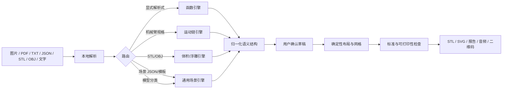

# 触见 TouchLearn

把多模态 STEM 学习材料转成**可打印、可触摸、可扫码听讲**的触觉产物。

2026 复旦大学未来智造智能体大赛 · Team Stella

TouchLearn 不是两个写死的案例。它是一套通用的“理解 → 确认 → 生成 → 合规检查”智能体：函数图和机械臂只是两个演示样例，电路、流程图、几何图形、坐标系、路线图、柱状图、细胞结构，以及用户上传的场景 JSON，都可以走同一条链路。核心几何、STL 和标准检查完全本地确定性执行；大模型只负责理解，不负责编造尺寸。

当前版本 **v0.2.0**。已经能端到端生成 STL、预览、合规报告、音频和二维码；**尚未完成实体打印验证和盲人用户测试**，这两点在本文和提交材料里都如实标注。

## 它解决什么问题

| 用户给出 | 智能体理解成 | 用户确认后得到 |
|---|---|---|
| 函数图片或 `x^2-2x-3` | 解析式、视窗、零点、极值 | A5 函数触觉板 |
| 机械臂照片、工程图、文字描述 | 自由度、连杆、关节、末端 | 缩放立体模型或 A5 浮雕板 |
| STL / OBJ | 网格健康、包围盒、水密性 | 缩放立体或高度场浮雕 |
| 电路/流程图/几何/细胞/路线/柱状图 | 图块、图元、阅读顺序 | A5 结构触觉板 |
| PDF / TXT / JSON | 文字层、场景结构 | 对应的函数、机械臂或场景草稿 |
| 无法结构化的散文 | 明确拒绝 | 不生成无意义的板子 |

输出统一包含：`model.stl`、`preview.svg`、`compliance.json/md`、`diagram.json`、`decision_trace.json`、`manifest.json`、中文音频脚本与播放页、二维码贴纸、打印说明。用户拿 STL 去自己的切片软件和打印机；TouchLearn 不负责实体打印。

## 快速开始

### 1. 启动交互式前端（推荐）

仓库自带嵌入式 Python，不读 `PYTHONPATH`，用启动脚本：

```bash
python scripts/run_agent.py --port 8765
```

浏览器打开 `http://127.0.0.1:8765`。默认监听 `0.0.0.0`，同一 Wi-Fi 下的手机可以扫码访问音频页。

关闭自动打开浏览器：

```bash
python scripts/run_agent.py --port 8765 --no-browser
```

### 2. 接入大模型（可选）

不配置也能离线演示：分类走关键词，函数走正则，场景走 8 个离线模板，图片只留档不猜。要启用图片理解和自由文字生成场景，复制 `.env.example` 为 `.env`，填一个 OpenAI 兼容服务：

```dotenv
TOUCHLEARN_LLM_PROVIDER=dashscope
TOUCHLEARN_LLM_KEY=sk-...
```

视觉模型默认复用同一预置；自定义网关时再填 `TOUCHLEARN_VLM_*`。支持 OpenAI、DeepSeek、阿里云百炼/通义千问、月之暗面/Kimi、智谱 GLM、本地 Ollama/vLLM 和任意兼容接口。详细配置、端点语义、失败行为见 [docs/providers.md](docs/providers.md)。

密钥只从环境变量或本机 `.env` 读取，不写入作业目录，状态接口只返回 `has_key`。

### 3. 命令行构建两个基准案例

```bash
python scripts/dev_cli.py validate examples/robot_arm/diagram.json
python scripts/dev_cli.py all examples/robot_arm/diagram.json -o dist/robot-arm-6axis
python scripts/dev_cli.py all examples/quadratic/diagram.json -o dist/quadratic-y-x2-2x-3
```

刷新两个案例的 `dist/`、`docs/images/` 和清单：

```bash
python scripts/build_examples.py
```

### 4. 普通 Python 环境

```bash
python -m venv .venv
# Windows: .venv\Scripts\activate
# macOS/Linux: source .venv/bin/activate
pip install -e ".[dev]"
touchlearn all examples/quadratic/diagram.json -o dist/quadratic-y-x2-2x-3
```

可选依赖：

- `pip install -e ".[docs-reader]"`：读取 PDF 文字层（`pypdf`）。
- `pip install -e ".[qr]"`：二维码（已包含在基础依赖里）。
- `pip install -e ".[ui]"`：旧的 Streamlit 预览界面。

### 5. 跑测试

```bash
python -m unittest discover -t . -s tests
```

测试不调用任何付费接口；模型接入用本机临时 HTTP mock。

## 架构



关键约束：

- **语义是唯一真源**。场景用归一化 0–100 坐标，模型不给毫米；函数曲线由系数采样；机械臂由运动链计算。
- **模型不改合规结论**。PASS / DEVIATION / NEEDS_REVIEW / FAIL 全部由本地规则引擎产生。
- **先确认再构建**。草稿可改函数视窗、机械臂参数、场景标题；未确认不生成 STL。
- **离线可复现**。三角化、棱柱、STL、盲文和笔画字体用标准库实现；8 个模板断网可用。
- **不确定就拒绝**。看不清的图片、没有文字层的扫描 PDF、无法结构化的散文，不会被硬编成一个结构。

## 通用场景编译器

当前支持 8 个离线模板：三角形与高、3-4-5 直角三角形、串联电路、流程图、平面直角坐标系、路线图、柱状图、植物细胞。

场景图元包括线/折线/路径、多边形、矩形、圆、椭圆、箭头、圆弧、点、文字、盲文。最多 12 个图块，每块最多 48 个图元；按阅读顺序自动编号，标签在全部几何生成后统一做碰撞避让，并避开标题和二维码区。

8 个模板都通过了网格水密和可打印性检查，无 FAIL。它们仍只是**结构示意图**：表达位置、连接关系和顺序，不还原照片细节，也不代表真实尺寸。

## 标准依据

主依据是 [GB/T 40142-2021《触摸图形设计及图例》](https://openstd.samr.gov.cn/bzgk/std/newGbInfo?hcno=E72CE9A9B4200759B27F08F13118F5B8)，盲文点阵依据 [GB/T 39758-2021](https://openstd.samr.gov.cn/bzgk/std/newGbInfo?hcno=63A112B519D601DBA74264AAEB314DB0)（等同 ISO 17049:2013）。同时核对了 GB/T 44725-2024、GF 0019-2018、国歌盲文方案、GB/T 45281-2025、GB/T 45567-2025、GB/T 18028-2010 的适用范围和状态。

必须说清楚的三点：

- GB/T 40142 的公开 PDF 只有封面和目录，仓库里的点径、线高、标注距离来自民政部公开解读，属于**公开摘要级证据**，不是逐条抄录条款。
- GB/T 15720-2008 已于 2025-11-03 废止且无替代，不能再作为现行依据。
- 单张 A5 触觉板不是盲文出版物，GB/T 44725 只在输出盲文书册/说明页时适用。

完整题录、日期、链接、合规矩阵和“不能宣称的内容”见 [docs/standards/evidence.md](docs/standards/evidence.md)。

## 一次构建产出什么

作业目录 `outputs/jobs/<job_id>/` 下：

| 文件 | 内容 |
|---|---|
| `model.stl` | 二进制 STL，可直接切片 |
| `preview.svg` | 与几何同源的矢量预览 |
| `qr.png` / `qr_card.svg` | 指向音频页的二维码与贴纸卡 |
| `audio.html` | 扫码后的本地播放页 |
| `narration.wav` / `audio_script.txt` | 中文语音与文字稿 |
| `compliance.json` / `compliance.md` | 逐条规则检查结果 |
| `diagram.json` | 本次构建的语义快照 |
| `decision_trace.json` | 路由、版式、检查的决策轨迹 |
| `manifest.json` | 标题、模式、几何指标、哈希 |
| `README.txt` | 给打印者的说明 |

两个基准案例的 STL 水密、体积为正、尺寸 148 × 210 × 3.8 mm，可打印性为 PASS。数字以 `dist/manifest.json` 和各作业的 `report.json` 为准。

## 仓库结构

```text
src/touchlearn/
  model.py schema.py            语义模型与校验
  layout.py                     确定性布局调度
  braille.py font.py            盲文点阵与 3×5 笔画字体
  geometry.py printability.py   三角化、网格、可打印性门禁
  svg.py stl.py                 预览与二进制 STL
  cli.py                        命令行
  agent/
    agent.py                    四段式编排、草稿、构建
    router.py                   意图分类与函数抽取
    llm.py                      多供应商 OpenAI 兼容传输
    vision.py                   图片理解适配
    documents.py                PDF/TXT/JSON 文字读取
    scene.py                    通用场景编译器与 8 个模板
    standards.py                规则引擎
    server.py                   本地 HTTP API
    static/                     交互式前端
examples/                       两个基准案例
schemas/                        对外 JSON Schema
tests/                          单元测试
scripts/                        启动、构建、二维码工具
docs/                           架构、规格、标准证据、产品蓝图、提交材料
dist/                           两个基准案例产物
fabrication/                    盲测材料与打印说明
```

## 当前状态与边界

已经做到：

- 函数、机械臂、三维、通用场景四条链路端到端构建；
- 8 个场景模板全部通过合规检查，无 FAIL；
- 图片、PDF 文字层、TXT/JSON、STL/OBJ 都能进入对应解析路径；
- 多家大模型 API 的统一接入与离线降级；
- 草稿确认、可编辑、构建进度、产物下载、二维码与音频；
- 单元测试覆盖几何、布局、标准、路由、模型、文档、服务端。

尚未做到，不在 README 里含糊：

- **没有实体打印验证**。STL 只经过几何、水密和可打印性检查，未经过真实切片与打印机。
- **没有盲人用户测试**。`docs/blind_test_protocol.md` 是可执行方案，不是已完成结论。
- **扫描版 PDF 不能直接读图**。没有文字层时需要导出 PNG 并配置视觉模型；当前不内置 PDF 光栅化。
- **3D 照片重建不是目标**。机械臂图片用于理解结构，不承诺从单张照片还原真实尺寸。
- **汉语盲文转写未实现**。板面使用数字索引和短英文标签，中文在音频与说明里。
- **盲文书册版式未实现**。GB/T 44725 只在未来输出书册时适用。

## 文档

- [产品蓝图](docs/product/blueprint.md)
- [大模型接入](docs/providers.md)
- [标准证据表与合规矩阵](docs/standards/evidence.md)
- [架构与数据契约](docs/architecture.md)
- [触觉板规格](docs/tactile_spec.md)
- [Windows 运行说明](docs/run_windows.md)
- [盲测方案](docs/blind_test_protocol.md)
- [初赛提交清单](docs/submission.md)
- [路线图](docs/roadmap.md)

## 许可

代码使用 MIT License，见 [LICENSE](LICENSE)。文档、示例 JSON、生成的触觉板设计与预览使用 CC BY 4.0，见 [LICENSE-docs](LICENSE-docs)。

仓库不包含第三方照片；机械臂是原创示意图，不复制具体厂商的产品图。
