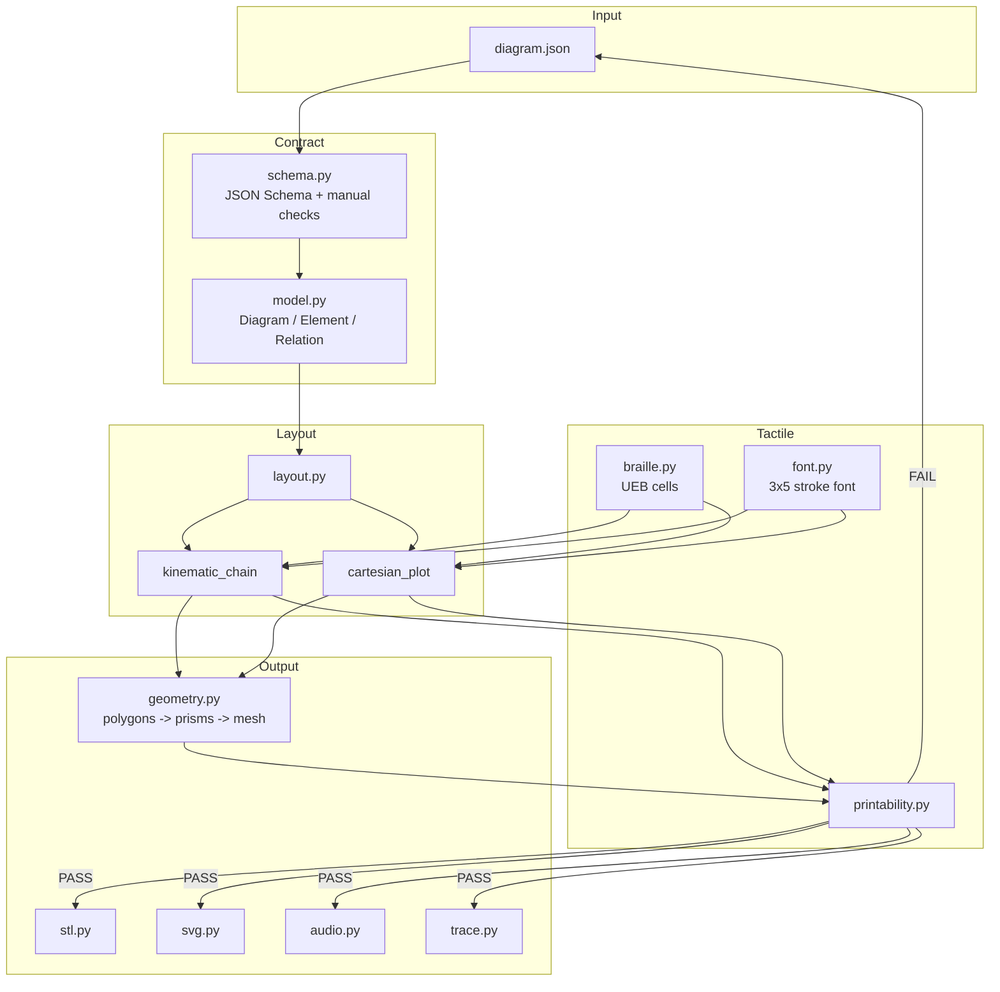

# 架构与数据契约

本文说明 TouchLearn v0 如何从一份语义 JSON 走到一块可切片的触觉板，以及哪些地方是刻意保持简单的。

## 1. 设计原则

### 语义优先，不做像素描摹

输入不是照片，而是对图的结构化描述：元素、关系、关键点、约束和讲解词。曲线由函数系数采样生成，关节位置由运动链和画布约束决定。这样做的直接好处是：

- 改一个函数系数，曲线、顶点、根和讲解顺序一起更新；
- 改一个连杆长度，后续布局自动重排，而不是手工拖图；
- 可以解释"为什么这里画成这样"，因为每一步都有 `trace.jsonl`。

v0 不包含"照片 → 语义结构"的自动提取。两个案例的 `diagram.json` 是人工整理的，`source` 字段记录来源类型和说明。这是一个明确的边界，不是隐藏的限制。

### 两个引擎，而不是一个万能布局器

机械臂是串联运动链，函数图是笛卡尔坐标系。两者的布局约束几乎不重叠：前者关心关节顺序和腕部密度，后者关心比例尺和曲线采样。v0 用两个小引擎分别把问题做对，而不是造一个无法验证的通用求解器。

### 先检查，再出件

`build` 和 `all` 在写出 STL 之前已经完成布局、网格和可打印性检查。任何 error 级问题都会让命令返回非零退出码。检查失败时不能靠切片软件"修一下"，要回到语义模型或布局引擎改。

## 2. 管线

## 3. 数据契约

`schemas/diagram.schema.json` 是 Draft 2020-12 schema，`src/touchlearn/data/diagram.schema.json` 是它的包内副本；测试会强制两份文件一致。

顶层字段：

| 字段 | 作用 |
|---|---|
| `schema_version` | 固定 `0.1.0` |
| `id` | 小写字母、数字和连字符，决定输出目录名 |
| `title` / `title_zh` | 英文与中文标题 |
| `domain` | `robotics` / `math` / `other` |
| `canvas` | 画布尺寸与边距；v0 布局器按 A5 设计 |
| `source` | 来源类型、引用和说明 |
| `elements` | 1–12 个语义元素 |
| `relations` | 元素之间的连接、关节、包含等关系 |
| `layout` | 引擎名和引擎参数 |
| `constraints` | 线宽、间距、板厚、浮雕、盲文尺寸 |
| `audio` | 开场、分步讲解、结束语 |

元素支持的 `kind`：`link`、`joint`、`joint_group`、`end_effector`、`curve`、`point`、`axis`、`label`、`legend`、`other`。关系支持的 `kind`：`joint`、`connect`、`contains`、`on_curve`、`through`、`other`。

`schema.py` 除了跑 JSON Schema，还做一组手写检查，因为 schema 无法表达所有触觉约束：

- 元素 id 唯一；
- 关系两端必须存在；
- 画布必须是 A5（v0 的布局器不支持 A4）；
- 线宽低于 1.0 mm、间距低于 4.0 mm、浮雕不在 0.4–0.8 mm 内直接拒绝；
- 非数值的约束字段不会让校验器崩溃，而是给出可读错误。

手写检查是有意保留的：它让核心包在没有 `jsonschema` 的嵌入式 Python 上也能工作。

## 4. 布局层

### 坐标约定

布局使用毫米，原点在 A5 左上角，x 向右，y 向下。这样排版的直觉和 SVG 一致。到了几何层，y 会翻转为 `height - y`，变成常见 3D 坐标系（原点左下）。这个转换只发生一次，避免出现"布局里翻一次、导出时又翻一次"的双重翻转。

### `kinematic_chain`

机械臂版式按侧视串联链放置：

- 基座在底部，J1 位于基座上缘；
- L1 竖直向上，L2 向右上，L3 继续向右上；
- J4–J6 不直接挤在一条细线上，而是放进 18 × 42 mm 的腕部放大板，三个关节按 12 mm 间距排开；
- 末端执行器用两指夹爪轮廓，和腕部板保持连接；
- 8 个语义元素用数字 1–8 标注，数字同时有 6 mm 高的笔画文字和下方 7.5 mm 处的盲文单元。

腕部放大板是这套布局里最重要的取舍：如果按真实比例把 J4、J5、J6 画在一条 9 mm 宽的连杆上，三个 6 mm 的关节圆会连成一个无法分辨的凸块。放大板牺牲了严格比例，换来了可分辨的关节顺序，`trace.jsonl` 明确记录了这个决定和理由。

### `cartesian_plot`

函数图按 10 mm/单位绘制，定义域 `[-2, 4]`，值域 `[-5, 6]`：

- 曲线由 `a=1, b=-2, c=-3` 采样 49 段生成，不读任何图片；
- 主网格每 2 个单位，避免 1 单位网格在触觉上盖过曲线；
- 对称轴 `x=1` 用虚线；
- 顶点 `(1, -4)`、左根 `(-1, 0)`、右根 `(3, 0)` 由系数计算，分别编号 1、2、3；
- 坐标轴和原点用短盲文 `x`、`y`、`o`，避免大写符号让标签变宽。

曲线采样点数和网格密度都是显式常量，改它们会改变 `trace.jsonl` 里的决策记录，但不会改变输入语义。

## 5. 触觉图元与几何

布局层只产生五种图元：

| 图元 | 字段 | 转成几何的方式 |
|---|---|---|
| `polyline` | 点列、线宽、是否闭合 | 每段生成矩形，拐点生成圆，合并为闭合棱柱 |
| `polygon` | 点列 | 耳切三角化后拉伸为棱柱 |
| `circle` | 圆心、半径 | 24 边形拉伸为棱柱 |
| `text` | 位置、字符串、字高 | 3×5 笔画拆成线段，再走 `polyline` 的膨胀逻辑 |
| `braille` | 位置、字符串 | 每个点生成 10 边形小棱柱 |

所有图元都从 `z = 板厚 - 0.05 mm` 拉伸到 `z = 板厚 + 浮雕高度`。嵌入 0.05 mm 是为了让图元和底板重叠，而不是刚好共面；切片器会把重叠部分合并。

每个图元单独成为一个闭合棱柱，棱柱之间在平面上重叠时，网格在拓扑上仍然是多个壳。为了让 `is_watertight()` 的"每条边恰好出现两次"成立，构建时给每个壳加一个亚微米级的 z 偏移（`1e-7 mm` 量级）。这不会影响打印，也避免了不同壳的边在数值上完全重合。

耳切三角化是标准库实现，支持凹多边形；`ensure_ccw` 在翻转 y 之后统一绕向，保证法线朝外、体积为正。`Mesh` 提供：

- 包围盒与尺寸；
- 体积（散度定理）；
- 边计数与水密判定；
- 三角形数、顶点数等统计。

## 6. 可打印性门禁

`printability.py` 的检查项：

| 检查 | 判据 |
|---|---|
| `feature_count` | 语义元素不超过 12 |
| `base_thickness` | 板厚 ≥ 3.0 mm |
| `relief` / `braille_height` | 0.4–0.8 mm |
| `edge_margin` | 所有特征在 5 mm 边距内 |
| `line_width` | 线宽、圆直径、文字笔画、盲文点径 ≥ 1.0 mm |
| `label_clearance` | 标签与其他特征净空 ≥ 1.2 mm（相连元素和图元除外） |
| `label_collision` | 标签之间 ≥ 4.0 mm |
| `qr_zone` | 除二维码区自身外，任何特征不侵入右下 30 × 30 mm |
| `mesh_bounds` | 网格不超出画布 |
| `mesh_height` | 最高点 ≤ 4.0 mm |
| `mesh_volume` | 体积为正 |
| `mesh_watertight` | 每条边恰好被两个三角形共享 |

已知的简化：

- 二维码区坐标目前是 A5 的固定值 `(113, 175, 30, 30)`，与布局器的 A5 假设一致；
- 标签净空用多边形距离计算，但先用包围盒做剪枝，因此极端凹形可能偏保守；
- 网格水密性检查的是拓扑，不检查自交；切片前仍应在切片软件里做一次视觉检查。

## 7. 输出与可追溯性

`cli.py` 的 `_compile` 是唯一的构建入口，`build` 和 `all` 都走它。一次构建写出：

- `model.stl`：二进制 STL，80 字节头 + 三角形数 + 每三角形 50 字节；
- `preview.svg`：从同一 `LayoutResult` 渲染，颜色只用于预览，不参与几何；
- `report.json`：`passed`、`issues`、`metrics`；
- `trace.jsonl`：每行一个事件，字段为 `timestamp`、`stage`、`action`、`decision`、`reason`、`evidence`；
- `audio.txt`：中文讲解脚本；
- `diagram.json`：输入快照。

`trace.jsonl` 的时间戳让两次构建的文件不完全相同，但 STL 和 SVG 是确定性的。`dist/manifest.json` 只记录 STL 的 SHA256、网格统计和检查结论，不记录生成时间，方便做版本对比。

## 8. 确定性

对同一份 `diagram.json` 和同一版代码：

- 布局坐标是常量与显式公式，不含随机数；
- 曲线采样点数和顺序固定；
- 三角化按顶点顺序和耳切规则执行；
- 盲文点阵和笔画字体是查表；
- STL 头固定为 `TouchLearn v0.1.0 - Team Stella`。

测试里对同一输入构建两次并比较三角形列表与 STL SHA256，防止引入隐含的随机性。

## 9. 扩展点

如果要把 v0 扩到更多图：

1. **新引擎**：在 `layout.py` 增加 `_layout_xxx`，在 `build_layout` 注册；schema 的 `layout.engine` 枚举同步扩展。
2. **新图元**：在 `layout.Primitive`、`primitive_bbox`、`geometry.primitive_polygons`、`svg._primitive_svg` 和 `printability._primitive_min_width` 五处同步增加，缺一处就会在测试里暴露。
3. **新检查**：在 `printability.check_layout` 增加 error 级 issue，并在 `tests/test_printability.py` 加一个反例。
4. **上游提取**：如果要接照片，建议单独做一个 `extract` 阶段，输出仍然落到本契约的 JSON；不要把视觉模型直接塞进布局器，否则确定性会丢失。

## 10. 为什么不用 trimesh / numpy / CadQuery

核心包的目标是"在任何一台装有 Python 的电脑上可复现"。v0 的几何规模很小（两万多个三角形），标准库足够；引入 CAD 依赖会让嵌入式 Python 和 CI 都变复杂，也会让"为什么这个面是这样"更难解释。等案例数量或几何复杂度上来，再评估是否替换。
