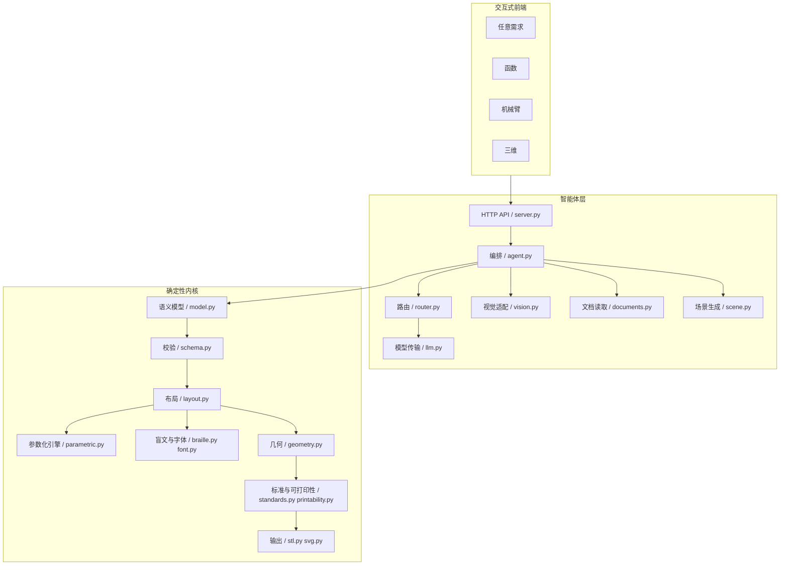

# 架构与数据契约（v0.2）

本文说明 TouchLearn 如何从一次多模态请求走到一块可切片的触觉板，哪些环节由模型完成，哪些环节必须保持确定性。

## 1. 设计原则

### 模型只做理解，几何必须可复现

大模型负责分类、读图、抽取表达式和生成归一化场景结构；它**不**输出毫米坐标，也**不**决定 PASS/FAIL。几何尺寸、碰撞、三角化、水密和标准检查全部由本地代码计算。这样做的直接好处是：

- 同一份语义结构重复构建，STL 完全一致；
- 模型换供应商不影响几何结果；
- 每个判断都能在 `decision_trace.json` 和 `compliance.json` 里找到依据。

### 四种输入，四条确定性链路

| 输入 | 上游理解 | 确定性编译 |
|---|---|---|
| 函数图片/文字/PDF | 视觉模型或正则提取解析式 | `function_plot` |
| 机械臂图片/工程图/描述 | 视觉模型或参数抽取 | `robot_relief` 或体积模型 |
| STL/OBJ | 本地网格解析 | 缩放立体或高度场浮雕 |
| 电路/流程图/几何/细胞等 | 模型生成场景 JSON 或离线模板 | `scene` |

四个引擎共享同一套画布、图元、几何、可打印性和输出代码，不各写一套。

### 先确认，再出件

`POST /api/analyze` 只产生草稿，不写 STL。用户可以改：

- 函数：解析式、x/y 视窗；
- 机械臂：自由度、代表连杆长度、末端执行器、输出形态、目标高度；
- 三维：输出形态、目标高度、浮雕分辨率；
- 场景：标题、图块顺序、图块标签。

`POST /api/build` 才进入构建。构建失败时保留作业目录和错误信息，不返回一个看似成功的空文件。

### 不确定就拒绝

扫描 PDF 没有文字层、图片看不清、描述缺少连接关系、请求无法结构化时，草稿标记 `ready=false` 并给出补充建议。系统不会为了“有输出”而编造结构。

## 2. 分层



### 2.1 智能体层

- `server.py`：本地 HTTP 服务、静态资源、草稿/作业接口、二维码与音频路由。
- `agent.py`：保存上传、读取文档、路由、生成草稿、确认后构建、写合规报告和清单。
- `router.py`：意图分类与函数抽取，模型优先、关键词兜底。
- `llm.py`：OpenAI 兼容传输，覆盖多家预置；不硬编码密钥。
- `vision.py`：图片理解的任务提示与字段校验；未配置时明确返回“只留档”。
- `documents.py`：PDF/TXT/JSON 文字读取与场景 JSON 识别。
- `scene.py`：归一化场景、图元校验、8 个离线模板、场景讲解词。

### 2.2 确定性内核

- `model.py` / `schema.py`：语义契约与手写校验。
- `layout.py`：按 `layout.engine` 分派到具体引擎。
- `parametric.py`：函数与机械臂的参数化布局。
- `geometry.py`：耳切三角化、闭合棱柱、网格统计。
- `standards.py`：标准规则注册表与合规报告。
- `printability.py`：边距、线宽、标签碰撞、二维码区、网格边界等几何检查。
- `stl.py` / `svg.py`：二进制 STL 与同源 SVG。

## 3. 数据契约

`schemas/diagram.schema.json` 是 Draft 2020-12 schema，`src/touchlearn/data/diagram.schema.json` 是包内副本；测试强制两份一致。

- `schema_version`：`0.1.0`（两个基准案例）或 `0.2.0`（智能体生成的函数/机械臂浮雕/场景）。
- 顶层字段：`id`、`title`、`title_zh`、`domain`、`canvas`、`source`、`elements`、`relations`、`layout`、`constraints`、`audio`。
- `domain`：`robotics` / `math` / `scene` / `other`。
- `layout.engine`：`kinematic_chain` / `cartesian_plot` / `function_plot` / `robot_relief` / `scene`。
- `elements`：1–12 个语义元素，`kind` 包含 `link`、`joint`、`curve`、`point`、`axis`、`label`、`legend`、`scene` 等。
- `relations`：`joint`、`connect`、`contains`、`on_curve`、`through`、`reading_order`、`other`。

场景的完整几何不塞进 `elements`，而是放在 `layout.options.scene`：

```json
{
  "schema_version": "0.2.0",
  "layout": {
    "engine": "scene",
    "options": {
      "scene": {
        "title": "SERIES CIRCUIT",
        "blocks": [
          {
            "id": "battery",
            "label": "BATTERY",
            "label_zh": "电池",
            "primitives": [{"type": "rect", "x": 20, "y": 40, "w": 30, "h": 12}]
          }
        ]
      }
    }
  }
}
```

`elements` 是场景块在语义层的投影，负责编号、阅读顺序和音频；`layout.options.scene` 是几何真源。两者由同一个场景对象生成，不会各改一份。

`schema.py` 除 JSON Schema 外还做手写检查，因为嵌入式 Python 可能没有 `jsonschema`：

- 元素 id 唯一、关系两端存在；
- 画布为 A5 148 × 210；
- 线宽低于 1.0 mm、间距低于 4.0 mm、浮雕不在 0.4–0.8 mm 内直接拒绝；
- 非数值约束不会让校验器崩溃。

## 4. 智能体管线

### 4.1 上传与本地读取

`agent.py` 将上传写到 `outputs/drafts/<draft_id>/uploads/`，计算字节数与 SHA256，并按扩展名分流：

| 扩展名 | 读取方式 |
|---|---|
| PNG/JPG/WEBP/BMP | 记录尺寸、色彩模式；视觉模型可选 |
| PDF | `pypdf` 读文字层；无文字层明确提示扫描件 |
| TXT/JSON | UTF-8/GB18030/UTF-16 解码，限 60,000 字符 |
| STL/OBJ | 本地解析三角面、包围盒、水密性 |

文本内容会拼进本次请求的文字上下文，所以用户可以直接上传一份练习册文本，不必再手打一遍。JSON/TXT 中如果含有 `blocks` 场景对象，会被识别为显式场景，跳过模型生成。

### 4.2 路由

`router.classify_request` 的优先级：

1. 显式场景 JSON 或模板 → `scene`；
2. 显式解析式 → `function`；
3. 显式机械臂规格 → `robot`；
4. 只有 STL/OBJ → `mesh`；
5. 有文本/图片 → 模型分类；
6. 模型不可用 → 关键词评分；
7. 都不成立 → `unsupported`。

每个决定写进草稿的 `fields.routing`：`subject`、`confidence`、`reason`、`provider`、`notes`、`questions`。前端直接展示理由，评委可以看到“为什么走这条链路”。

### 4.3 草稿

四种草稿共用 `Draft` 结构：

```text
id, subject, output_mode, confidence, ready,
fields, questions, notes, files, created_at
```

- `ready=false` 时构建按钮禁用；
- 场景草稿额外带 `suggested_templates`，前端渲染为可点击模板卡；
- 函数草稿带 `key_points`，机械臂草稿带 `spec` 和 `target_height_mm`；
- 文件列表只带文档元数据（字符数、页数、消息），不把全文塞回浏览器。

### 4.4 构建

`build()` 读取 `draft.json`，合并用户覆盖字段，创建作业目录，然后按 `subject` 分派：

- `_build_function` → `build_function_layout` → 网格；
- `_build_robot_relief` → `build_robot_layout`；
- `_build_robot_volume` → 运动链体积模型；
- `_build_mesh` → 缩放立体或高度场浮雕；
- `_build_scene` → `normalize_scene` → `diagram_from_dict` → `build_layout` → `build_mesh`。

构建过程通过 `report_progress` 写 `job.json`，前端轮询 `/api/jobs/<id>`。完成后写合规报告、清单、二维码、音频和下载包。

## 5. 布局层

### 坐标约定

布局使用毫米，原点在 A5 左上角，x 向右，y 向下。几何层把 y 翻转为 `height - y`，只翻转一次。

### `function_plot`

- 解析式经本地解析器变成 AST，拒绝未知函数和非法字符；
- 自动视窗根据采样范围、零点和极值扩展；
- 曲线按固定步数采样，坐标轴、网格、零点、极值、对称轴分别成图元；
- 关键点自动编号，标签统一避让。

### `robot_relief`

- 运动链按侧视串联放置；
- 基座、连杆、关节、腕部、末端执行器分别成图元；
- 腕部三轴用放大板保证可分辨；
- 数字标签 + 盲文索引，中文在音频里。

### `scene`

1. `normalize_scene` 限块数、限图元、裁剪坐标到内容框、把椭圆转多边形、剔除不可打印字符；
2. 按 `reading_order` 排序，每块生成编号标签；
3. 所有块几何完成后再统一放置标签，避开标题、副标题、页脚和二维码区；
4. 每个块一个 `Feature`，`semantic_id` 指向场景块 id；
5. 生成 `reading_order` 关系链，供音频和报告使用。

内容框为 `(8, 24, 132, 142)` mm：标题在 `y=8.5`，副标题在 `y=17.4`，底部留给页脚和二维码。

## 6. 触觉图元与几何

布局层产生以下图元：

| 图元 | 字段 | 几何化 |
|---|---|---|
| `polyline` | 点列、线宽、是否闭合 | 每段矩形 + 拐点圆，合并为闭合棱柱 |
| `polygon` | 点列 | 耳切三角化后拉伸 |
| `circle` | 圆心、半径 | 24 边形拉伸 |
| `text` | 位置、字符串、字高 | 3×5 笔画拆线段，再按 polyline 膨胀 |
| `braille` | 位置、字符串 | 每点一个 10 边形小棱柱 |
| `arc` | 圆心、半径、起止角 | 采样为折线 |

所有图元从 `z = 板厚 - 0.05` 拉伸到 `z = 板厚 + 浮雕高度`。嵌入 0.05 mm 让图元与底板重叠，切片器会合并。

每个图元是独立闭合壳；构建时给每个壳一个亚微米级 z 偏移，使 `is_watertight()` 的“每条边恰好出现两次”成立，同时不影响打印。

## 7. 检查层

### 7.1 标准规则

`standards.py` 维护标准与规则的注册表，输出 PASS / DEVIATION / NEEDS_REVIEW / NOT_APPLICABLE。规则覆盖：

- 触摸点直径、线高、标注距离（GB/T 40142，公开摘要级）；
- 盲文点径、点高、隔离区（GB/T 39758 / ISO 17049）；
- 中文盲文与数学盲文能力边界（GF 0019、GB/T 18028）；
- 音频脚本（GB/T 45281 参考）；
- 已废止标准的显式排除（GB/T 15720）。

### 7.2 几何可打印性

`printability.py` 检查：

| 检查 | 判据 |
|---|---|
| `feature_count` | 语义元素不超过 12 |
| `base_thickness` | 板厚 ≥ 3.0 mm |
| `relief` / `braille_height` | 0.4–0.8 mm |
| `edge_margin` | 特征不进入边距 |
| `line_width` | 线宽、圆直径、文字笔画、盲文点径 ≥ 1.0 mm |
| `label_clearance` | 标签与其他特征净空 ≥ 1.2 mm |
| `label_collision` | 标签之间 ≥ 4.0 mm |
| `qr_zone` | 不侵入右下 30 × 30 mm |
| `mesh_bounds` | 网格不超出画布 |
| `mesh_height` | 最高点 ≤ 4.0 mm |
| `mesh_volume` | 体积为正 |
| `mesh_watertight` | 每条边恰好被两个三角形共享 |

这些是**工程门禁**，不等于国家标准条款检测。两者在报告里分栏呈现，避免把“通过内部检查”说成“通过国家标准”。

## 8. 输出与可追溯性

一次作业写出：

- `model.stl`：二进制 STL；
- `preview.svg`：从同一 `LayoutResult` 渲染；
- `compliance.json` / `compliance.md`：规则级结果；
- `diagram.json`：本次语义快照；
- `decision_trace.json`：路由、版式、检查；
- `manifest.json`：标题、模式、几何指标、哈希；
- `audio_script.txt`、`narration.wav`、`audio.html`；
- `qr.png`、`qr_card.svg`；
- `README.txt`、`bundle.zip`。

`decision_trace` 记录“为什么选这个引擎、为什么这个标签放在这里、为什么这条规则是 DEVIATION”。`manifest` 不记录生成时间，方便版本对比。

## 9. 确定性与失败

同一份语义 JSON 和同一版代码：

- 布局坐标是常量与显式公式，不含随机数；
- 曲线采样点数和顺序固定；
- 三角化按顶点顺序和耳切规则执行；
- 盲文点阵和笔画字体是查表；
- STL 头固定。

失败路径：

- 上传类型/大小不合法 → `ValueError`，前端 toast；
- 模型不可用 → 降级到关键词/模板，草稿注明；
- 场景无法归一化 → `ready=false` + 建议模板；
- 构建检查出现 FAIL → 作业标记失败，保留产物和报告，不假装成功；
- 音频合成失败 → 仍生成文字稿和播放页，报告标记待复核。

## 10. 扩展点

1. **新引擎**：在 `layout.py` 注册 `_layout_xxx`，同步 `schema.py` 的 `ALLOWED_ENGINES` 和 JSON Schema 枚举。
2. **新图元**：同步 `layout.Primitive`、`primitive_bbox`、`geometry.primitive_polygons`、`svg._primitive_svg`、`printability._primitive_min_width` 五处。
3. **新检查**：在 `standards.py` 注册规则，写清标准、证据级别和失败级别；在 `tests/` 加反例。
4. **新输入类型**：在 `documents.py` 加读取器，输出仍是纯文本或场景 JSON；不要把二进制直接塞进布局器。
5. **新模型供应商**：在 `llm.PRESETS` 加预置，或在 `.env` 用 `custom`；不要改业务代码。

## 11. 为什么不用 trimesh / numpy / CadQuery

目标是“任何一台装有 Python 的电脑都能复现”，包括没有 CAD 的嵌入式环境。当前几何规模在几万三角形量级，标准库足够；引入 CAD 依赖会让安装、CI 和解释成本都上升。等几何复杂度显著增加，再评估替换。
